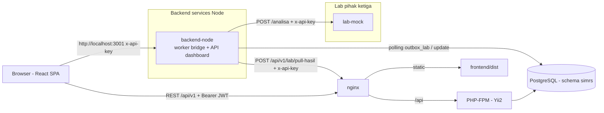

# Arsitektur

## Komponen

- **React SPA** satu origin dengan API (nginx). Navigasi dijaga `MenuGuard` (hak dari `GET /menu`); penegakan sebenarnya di Yii per endpoint.
- **Yii2** memegang seluruh business logic: master, pendaftaran, pemeriksaan, resep/stok, tagihan/pembayaran, laporan.
- **Node** (`services/backend-node`): worker bridge lab + REST dashboard read-only. Koneksi `simrs_svc` terbatas (outbox read/write; tabel bisnis read-only).
- **lab-mock**: simulasi lab pihak ketiga dengan API key.

## Alur integrasi lab (outbox pattern)

1. Dokter membuat order lab → Yii menulis `order_lab` (status `diminta`) + `outbox_lab` (`pending`, payload: kode kunjungan, jenis lab, pasien).
2. Worker Node polling outbox (`FOR UPDATE SKIP LOCKED`) → kirim ke mock lab → tulis balik outbox (`sent` + hasil).
3. Worker memanggil `POST /api/v1/lab/pull-hasil` (header `X-Api-Key`, tanpa JWT) → **Yii** memindahkan hasil ke `order_lab` (`selesai` + waktu) dan outbox menjadi `applied`.

**Gangguan integrasi (skenario D5):** mock lab tidak tersedia → worker gagal → `attempts++` + `last_error` di outbox, status tetap `pending` — transaksi klinik tidak pernah ikut gagal. Setelah 5 percobaan outbox jadi `failed` (data tetap ada); operator mengembalikan status ke `pending` (attempts direset) → worker mengirim ulang → `applied`. Tidak ada data yang hilang maupun ganda; bukti di `docs/bukti/7-lab/gangguan-integrasi.txt`.

## Otorisasi

- Login → JWT (HS256, 8 jam) berisi `sub/username/role_code`.
- Tiap request: JWT memvalidasi user; hak akses **dibaca dari database** (`user_access` ∩ `role_access`) per request — mencabut hak langsung berlaku.
- Menu sidebar = hasil `GET /menu` yang sudah difilter hak.

## Konsistensi data

- **Duplikasi pendaftaran** (D1): unik parsial `(pasien, jadwal, tanggal) WHERE status <> 'batal'` + counter antrean atomik (`INSERT … ON CONFLICT … RETURNING`).
- **Stok minus** (D2): penyerahan resep mengunci baris batch (`FOR UPDATE`) lalu mengalokasikan FEFO di dalam satu transaksi.
- **Pembayaran ganda** (D3): `pembayaran.idempotency_key` unik; retry dengan key sama mengembalikan pembayaran yang sudah ada.
- **Perubahan data pemeriksaan setelah billing** (D4): tagihan adalah snapshot; perubahan sesudahnya tidak mengubah tagihan, dan setiap tulisan master/transaksi tercatat `log_aktivitas` (before/after, IP, pelaku).
- **Performa** (D6): seeder 95 rb kunjungan + EXPLAIN before/after di `docs/bukti/8-performa/`.
