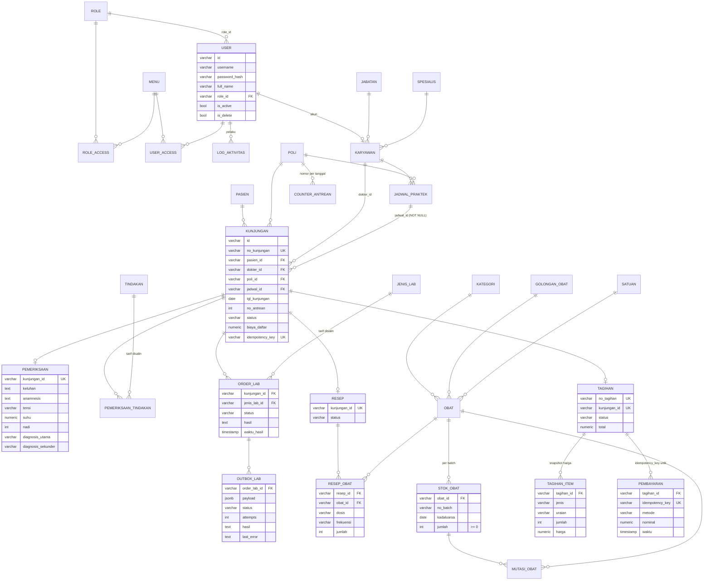

# ERD — SIMRS Rawat Jalan

Semua PK/FK `varchar(50)` UUID4. Setiap tabel punya kolom audit `create_date, create_by, update_date, update_by` (tidak digambar agar ringkas).

Relasi dan aturan penting:

- `kunjungan`: unik `(poli, tanggal, no_antrean)`; unik parsial `(pasien, jadwal, tanggal) WHERE status <> 'batal'` dengan `jadwal_id NOT NULL` (pendaftaran selalu lewat jadwal).
- `order_lab`: unik parsial `(kunjungan, jenis_lab) WHERE status <> 'batal'`.
- `stok_obat`: unik `(obat, no_batch)`; check `jumlah >= 0`.
- `tagihan`: unik per `kunjungan`; `pembayaran.nominal > 0` dan tidak boleh melebihi sisa (dicek aplikasi).
